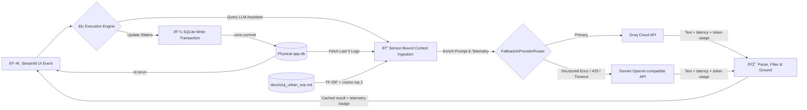

# 🗺️ Smart City Cluj-Napoca — Operational Architecture & Workflow Logic

This document describes the real logical, transactional, and computational pipeline of the Smart City platform. The structure strictly follows the Separation of Concerns principle, isolating data flows to guarantee local integrity and deterministic execution.

---

## 🔁 1. Transactional Data Pipeline (IoT Ingestion Flow)

On every operational cycle or platform launch, data follows a linear path protected by static and constant-time cryptographic control barriers:

```mermaid
gantt
    title Sequential IoT Data Circuit
    dateFormat  X
    axisFormat %s

    section Ingestion & Validation
    Context Initialization (.env / Structure) :active, p1, 0, 10
    Database Scaffolding (CityRepository)     :p2, after p1, 15

    section Security & Audit
    Operator Auth Barrier (Argon2id + HMAC)   :p3, after p2, 10
    Alert Threshold Eval & 10s Cooldown       :p4, after p3, 15
    Audit Ingestion (security_alerts.log)     :p5, after p4, 10

    section Rendering & AI
    Pearson Matrix & ML Extrapolation         :p6, after p5, 15
    Context-Aware Grounding (LLM Inference)   :p7, after p6, 20
```

### Computational Details by Stage:

1. **Dynamic Scaffolding (`main.py` -> `CityRepository.initialize_database`):**
   The application uses `DATABASE_PATH` (falling back to `app.db`). At startup, `CityRepository.initialize_database()` creates the `sensors`, `city_stats`, and `settings` tables, and `SmartCityApplicationEngine.initialize()` invokes the idempotent seeder on the same SQLite path. An empty database is populated with the 7 Cluj-Napoca monitoring stations, default thresholds, and demo telemetry; if any operational table already contains records, the seeder preserves them. This bootstrap covers fresh runtimes such as Streamlit Community Cloud.

   The Dashboard page stops rendering with `st.warning` if the sensor list is empty or the active selection cannot be resolved. Settings and Analytics include similar guards so a missing active sensor never causes attribute access on `None`.

2. **Synchronous Cryptographic Interception (`AuthenticationService.verify_credentials`):**
   The submitted password is verified against the configured Argon2id hash, while username comparison uses constant-time `hmac.compare_digest`.

3. **Anti-Duplication Filter & Local Audit:**
   Live telemetry readings are evaluated against thresholds stored in SQLite. If a reading breaches a threshold (or drops below the threshold for soil moisture), the alert subsystem intercepts the packet, enforces a 10-second anti-spam cooldown barrier, and writes the sanitized event (anti-log-injection) to `security_alerts.log`.

---

## 🧠 2. User Request Lifecycle

When an operator updates parameters in the UI or queries the Urban AI Assistant, the platform executes the following decoupled logical flow:

### AI Intervention Workflow & Guardrails:

* **Context-Aware Grounding & Strict Sensor–Value–Unit Binding:**
  The assistant loads exclusively `app/ai/prompts.yaml` via `PromptRegistryLoader`; the Pydantic v2 `PromptTemplateConfig` schema is immutable, validated, and cached in memory. System instructions, output formatting rules, and anti-hallucination constraints are dispatched separately from the user template containing live telemetry and RAG context. Context includes the active UI language, authorized thresholds, the last 5 alerts, and the trend of the station's last 5 readings. `SopKnowledgeRetriever` indexes sections from `docs/cluj_urban_sop.md` using `TfidfVectorizer` and selects up to two relevant passages via `cosine_similarity`, injected into `[AUTHORIZED URBAN SOP CONTEXT]`. The `[RECENT TELEMETRY TREND]` remains strictly historical; without at least two valid readings, no directional trend is inferred. Numerical values in the RAG pipeline (`rag_pipeline.py`) and UI layer (`ai_interface.py`) are strictly bound to their sensor identifier, location, and measurement unit to prevent cross-sensor value mixing while preserving all 7 deterministic Native Guardrails.

* **Deterministic Grounding:**
  After receiving the model response, `UrbanAiAssistantComponent` appends—without additional LLM calls—the station name, any omitted current readings, and any breached configured thresholds not cited by the model. All injected values and thresholds originate exclusively from live telemetry and station settings.

* **End-to-End `system_prompt_only` & Telemetry Propagation:**
  The `system_prompt_only: bool = False` flag is propagated deterministically across the entire call chain (`UrbanAiAssistantComponent` -> `_cached_ai_completion` -> `FallbackAiProviderRouter` -> `GroqProvider` / `GeminiOpenAiProvider`), included in the `@st.cache_data` cache key, forwarded to the underlying API payload, and recorded in session telemetry without altering default (`False`) behavior for existing callers.

* **Multi-Provider Routing, Model Ordering & Robust Error Classification:**
  `FallbackAiProviderRouter` attempts `GroqProvider` first and switches to `GeminiOpenAiProvider` upon failure. Rather than relying on fragile string prefix checks, `is_provider_failure` classifies failures across multiple signals: typed exceptions (`APIStatusError`, `OpenAIError`, `GroqError`, `TimeoutError`, `ConnectionError`), HTTP status codes (`>= 400`, including `429`, `500`, `502`, `503`, `504`), structured telemetry metadata (`error`, `status_code`, `last_error`), and normalized failure patterns—while isolating legitimate numeric sensor telemetry (e.g., `503 µg/m³`) from HTTP status codes.
  `GeminiOpenAiProvider` uses the `openai` SDK against the official OpenAI-compatible endpoint (`https://googleapis.com`) with `GEMINI_API_KEY` from environment variables, `.env`, or `st.secrets`. Its candidate list (`_candidate_models`) always attempts `configured_model` first, followed by all deduplicated fallback models (`FALLBACK_MODELS`) without dropping any configured model. Both responses pass through deterministic numeric grounding, and the router reports total latency and token usage from the succeeding provider.

* **Gemini Correction Retry Policy (Cost vs. Fallback Trade-Off):**
  Iterative LLM correction retries on Gemini are intentionally omitted. Re-prompting with full RAG context doubles input token consumption and adds multi-second latency, whereas transient or capacity errors are already handled immediately by multi-model candidate fallback (`_candidate_models`) and provider switching (`Groq` ↔ `Gemini`), and output completeness is guaranteed deterministically by the post-generation grounding layer.

* **State Isolation:**
  Responses returned by the Groq API for target models such as `openai/gpt-oss-20b` are sanitized using regular expressions to strip internal reasoning blocks (`<think>...</think>`). The clean output is stored in `st.session_state` under a location-scoped key, isolating generative output from Streamlit's automatic rerun loop and preventing UI flickering or chat state loss.

* **Caching & Request Control:**
  Generation is triggered strictly by the recommendation action button. Results are cached via `@st.cache_data(ttl=300, show_spinner=False)` keyed on prompt, telemetry parameters, active language, and `system_prompt_only`; repeating an identical request within 5 minutes reuses the cached response and saves API tokens. The `Groq` client is initialized with `max_retries=0` to disable hidden SDK retry delays on HTTP 429, allowing immediate key rotation and fallback execution.

* **Live LLM Evaluation (`ai_tests/run_llm_eval.py`):**
  The evaluator relies exclusively on `app/ai/prompts.yaml` and the Groq → Gemini router. The generator uses `openai/gpt-oss-20b` for both generation and judging; the judge prompt receives only the generated response and the scenario's metric/threshold. All seven scenarios run deterministically in CLI/CI via `ThreadPoolExecutor(max_workers=1)` (configurable via `--scenarios` / `max_scenarios=3` in the About UI for free-tier token efficiency) with adaptive pacing from Groq rate-limit headers (`x-ratelimit-remaining-tokens` / `x-ratelimit-reset-tokens`, defaulting to `1.5s`). Transient HTTP 429 errors and empty payloads allow up to three retries using `Retry-After` or exponential backoff with jitter; exhausting Groq fallbacks triggers Gemini. Judge verdicts enforce a compact Pydantic-validated JSON schema (`faithfulness: int`, `passed: bool`, `max_tokens=40`, `temperature=0.0`), rate-limited runs are marked as skipped, and the mean faithfulness score is exported in `avg_faithfulness_score` and displayed on the About page. Scenario ordering and the JSON report contract remain compatible with GitHub Actions.

* **Fast Architecture Verification (`pages/4_About.py`):**
* **Fast Architecture Verification (`pages/4_About.py`):**
  The default verification mode uses independent execution strategies with `ThreadPoolExecutor` to run the full Pytest suite (`sys.executable -m pytest -q --disable-warnings` — **97 passing tests**) and the **7 deterministic Native Guardrails** in parallel. This mode makes zero external API calls, reusing the latest available LLM report or displaying `Cached / Skipped (Fast Mode)` if none exists. Live evaluation runs only when the user explicitly checks **Include Live LLM Eval (uses API tokens)**, keeping default architecture verification fast and zero-cost.

* **Modernized Layout Constraints:**
  To guarantee a clean visual experience, all buttons and page widgets strictly follow modern native Streamlit layout standards (`use_container_width=True` and stretch containers), eliminating legacy elements and console deprecation warnings.

