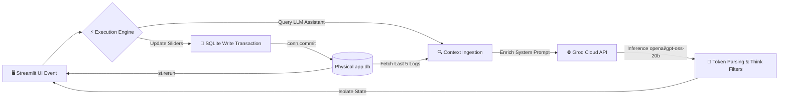

# 🗺️ Smart City Cluj-Napoca — Aplicație Operațională & Workflow Logic

Acest document descrie circuitul logic, tranzacțional și computațional real al platformei Smart City. Structura urmează cu strictețe principiul separării responsabilităților (Separation of Concerns), izolând fluxurile de date pentru a garanta integritatea locală și execuția deterministă.

---

## 🔁 1. Pipeline-ul Tranzacțional de Date (IoT Ingestion Flow)

La fiecare ciclu operațional sau lansare a platformei, datele urmează un traseu liniar, asigurat de bariere de control statice și criptografice în timp constant:

```mermaid
gantt
    title Circuitul Secvențial al Datelor IoT
    dateFormat  X
    axisFormat %s

    section Ingestie & Validare
    Inițializare Context (.env / Structură) :active, p1, 0, 10
    Scaffolding Bază de Date (CityRepository)  :p2, after p1, 15

    section Securitate & Audit
   Bariera de autentificare operator: Argon2id pentru verificarea parolei si hmac.compare_digest pentru compararea username-ului.
    Evaluare Praguri Alerte & Cooldown 10s   :p4, after p3, 15
    Ingestie security_alerts.log            :p5, after p4, 10

    section Randare & AI
    Calcul Matrice Pearson & Extrapolare ML  :p6, after p5, 15
    Context-Aware Grounding (Inference LLM)  :p7, after p6, 20
```

### Detalii Computaționale pe Etape:

1. **Scaffolding Dinamic (`main.py` -> `CityRepository.initialize_database`):**
   Aplicația folosește `DATABASE_PATH` (cu fallback pe `app.db`). La pornire, `CityRepository.initialize_database()` creează tabelele `sensors`, `city_stats` și `settings`, apoi `SmartCityApplicationEngine.initialize()` apelează seederul idempotent pe aceeași cale SQLite. O bază goală este populată cu cele 7 stații Cluj-Napoca, pragurile implicite și telemetrie demo; dacă există date în oricare dintre tabelele operaționale, seederul le păstrează. Acest bootstrap acoperă inclusiv runtime-ul proaspăt al Streamlit Community Cloud.

   Pagina Dashboard oprește randarea cu `st.warning` dacă lista de senzori este goală sau selecția nu poate fi rezolvată. Settings și Analytics au controale similare, astfel încât starea fără senzor activ nu provoacă acces la atributele unui obiect absent.

2. **Intercepție Criptografică Sincronă (`AuthenticationService.verify_credentials`):**
   Parola introdusa este verificata fata de hash-ul Argon2id configurat; compararea username-ului foloseste hmac.compare_digest.

3. **Filtru Anti-Duplicare și Audit local:**
   Valorile telemetrice live sunt evaluate în raport cu pragurile stocate în baza de date SQLite. Dacă o valoare depășește limita (sau scade sub prag în cazul umidității solului), sistemul de alerte interceptează pachetul, validează bariera temporală de 10 secunde cooldown anti-spam și stochează evenimentul igienizat (anti-log-injection) în fișierul fizic `security_alerts.log`.

---

## 🧠 2. Ciclul de Viață al unei Cereri de Utilizator (User Request Lifecycle)

Atunci când un operator modifică parametrii din interfața grafică sau interoghează Asistentul Urban AI, platforma execută următorul circuit logic decuplat:

### Workflow-ul de Intervenție AI & Guardrails:

* **Context-Aware Grounding (Ancorare Contextuală):**
  Atunci când asistentul inteligent din `app/ai/` pregătește un răspuns, el preia șablonul strict de instrucțiuni din `ai_tests/prompts.txt`, extrage dinamic limba activă din sesiune și accesează registrul de traduceri prin componenta `TranslationProvider`. Promptul final este îmbogățit cu limitele operaționale autorizate, ultimele 5 linii de alertă logate pe disc și un rezumat al ultimelor 5 citiri pentru stația selectată (`[RECENT TELEMETRY TREND]`). Tendința este marcată ca istorică; cu mai puțin de două înregistrări valide se declară indisponibilă, fără a deduce o direcție.

* **Grounding Determinist:**
  După răspunsul modelului, `UrbanAiAssistantComponent` completează fără apeluri LLM suplimentare numele stației, valorile curente omise și depășirile de prag configurate care nu au fost citate. Valorile și pragurile provin exclusiv din telemetria curentă și setările stației.

* **State Isolation (Izolarea Stării):**
  Rezultatele analizei returnate de API-ul Groq pentru modelul target `openai/gpt-oss-20b` sunt filtrate prin expresii regulate (regex) avansate pentru a elimina blocurile de gândire internă (`<think>...</think>`). Răspunsul curat este stocat în `st.session_state` folosind o cheie unică per locație. Acest lucru izolează datele generative în raport cu bucla automată de reîmprospătare (auto-refresh) a ecranului specifică Streamlit, eliminând complet efectul de pâlpâire sau pierderea datelor din ferestrele de chat.

* **Caching și controlul cererilor:**
  Generarea rămâne declanșată exclusiv de butonul de recomandări. Rezultatele sunt cache-uite prin `@st.cache_data(ttl=300, show_spinner=False)`, cu o cheie bazată pe prompt, parametrii telemetriei și limba activă; repetarea aceleiași cereri în intervalul de 5 minute reutilizează rezultatul și reduce consumul de tokeni. Clientul `Groq` este inițializat cu `max_retries=0`, dezactivând reîncercările automate ale SDK-ului la 429; providerul poate continua apoi cu rotația cheilor și modelele fallback fără o pauză ascunsă de retry.

* **Evaluarea live LLM (`ai_tests/run_llm_eval.py`):**
  Cele șapte scenarii rulează determinist cu `ThreadPoolExecutor(max_workers=1)` și spațiere de 2,1 secunde între fiecare încercare de cerere. Doar erorile tranzitorii HTTP 429 primesc o singură reîncercare cu backoff scurt și plafonat; cotele epuizate și celelalte erori nu sunt reîncercate. Promptul include pragurile autorizate ale stației, obținute prin `SensorThresholdMatrix`, în secțiunea `[AUTHORIZED OPERATIONAL THRESHOLDS]` și în contextul RAG. Ordinea scenariilor și formatul raportului JSON rămân compatibile cu About și GitHub Actions.

* **Verificare rapidă a arhitecturii (`pages/4_About.py`):**
  Modul implicit folosește un executor cu strategii independente și `ThreadPoolExecutor` pentru a rula în paralel suita Pytest (`sys.executable -m pytest -q --disable-warnings`) și guardrail-urile native in-process. Acest flux nu apelează API-ul Groq: reutilizează ultimul raport LLM disponibil sau afișează `Cached / Skipped (Fast Mode)` dacă nu există unul. Evaluarea live Groq este separată și pornește numai când utilizatorul bifează **Include Live Groq LLM Eval**; astfel verificarea implicită rămâne rapidă și nu consumă tokeni API.

* **Modernized Layout Constraints:**
  Pentru a garanta o experiență vizuală fluidă, toate butoanele și elementele din pagini folosesc exclusiv noul standard arhitectural nativ Streamlit (cum ar fi parametrul `use_container_width=True` sau containerele stretch), eliminând complet elementele legacy sau avertismentele (warnings) din consolă.
